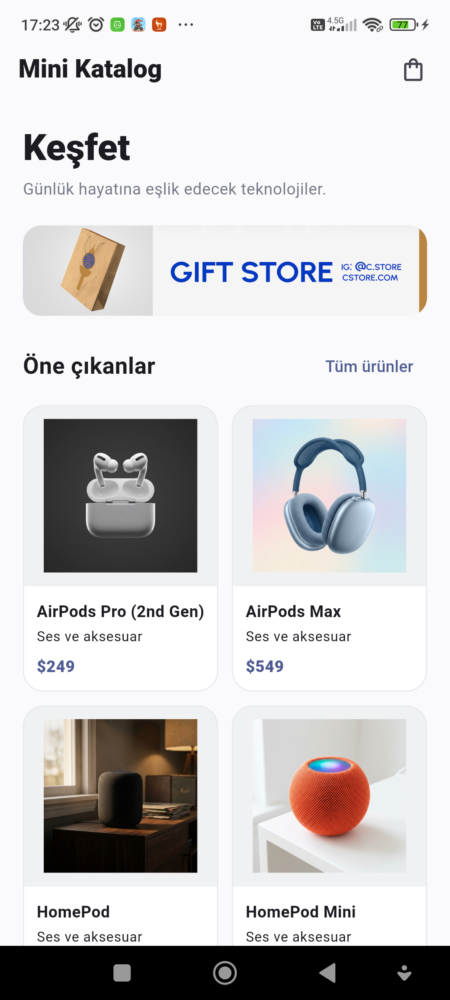
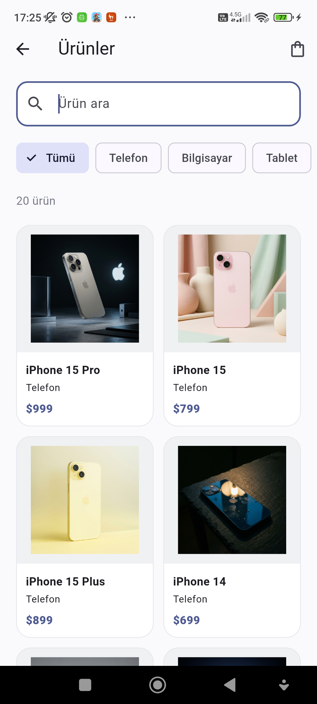
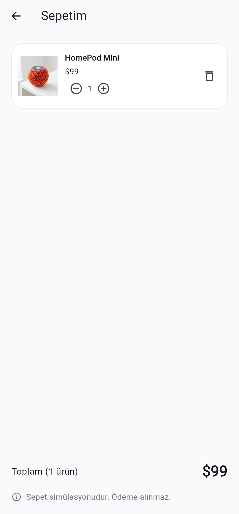
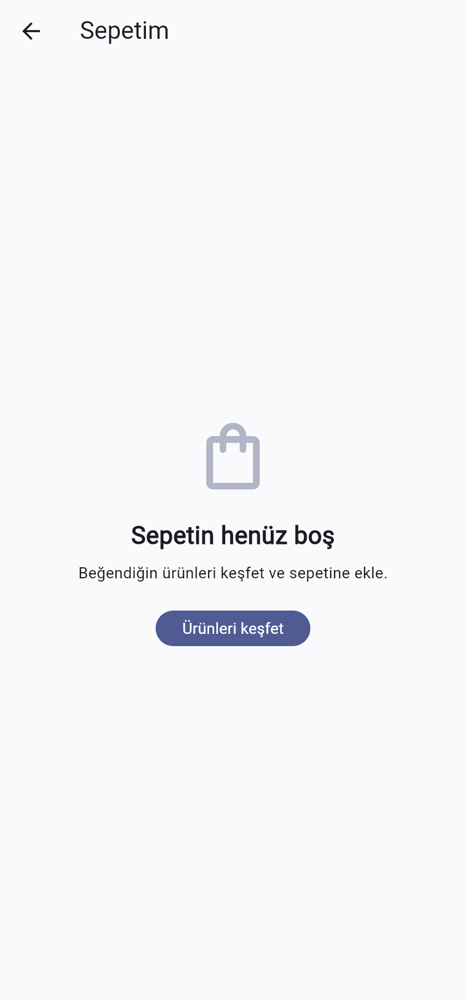

# Mini Katalog Uygulaması

Flutter ile geliştirilen; ürünleri listeleyen, kategoriye göre filtreleyen, ürün detaylarını gösteren ve sepet işlemlerini simüle eden mobil uygulama. Ürünler ve görseller yerel dosyalardan yüklenir.

Flutter sürümü: **3.38.3** · Dart sürümü: **3.10.1**

## Çalıştırma

Flutter SDK kurulu ve bir Android emülatörü veya cihaz bağlıyken proje klasöründe:

```bash
flutter pub get
flutter run
```

## Özellikler

- Ürün adına göre arama ve kategori filtreleme
- Ürün açıklamaları ve teknik özellikler
- Sepete ekleme, adet değiştirme, ürün silme ve toplam hesaplama
- Çevrimdışı ürün ve görsel erişimi

## Ekran görüntüleri

| Ana sayfa | Ürün listesi | Ürün detayı |
| --- | --- | --- |
|  |  |  |

| Sepet | Boş sepet |
| --- | --- |
|  |  |

Ürün verileri ve görseller: [WantAPI](https://wantapi.com/products.php) eğitim kaynağı. Ürün adları ve markalar ilgili sahiplerine aittir.
